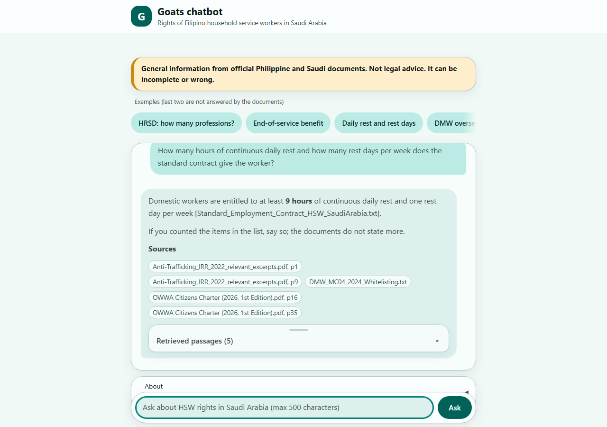

<p align="center">
  
</p>

<h1 align="center">Goats HSW Rights Chatbot</h1>
<p align="center">Official-document answers for Filipino household workers in Saudi Arabia — in English or Taglish.</p>

<p align="center">
  <a href="https://goats-hsw-rag-chatbot-626564095782.asia-southeast1.run.app"></a>
  
  
  
  
</p>

Goats is a retrieval-augmented chatbot for Filipino household service workers who are deployed to, or planning to work in, Saudi Arabia. It searches 16 official Philippine and Saudi documents, answers only from the retrieved passages, and shows the source files under every response.

Ask in English and the chatbot answers in English. Ask in Filipino or Taglish and it responds in simple Taglish.

> **This project provides general information from official documents. It is not legal advice, and its answers can be incomplete or wrong.**

## Why we built it

Rules about overseas employment, contracts, worker protections, benefits, and government services are spread across long documents from different agencies. Finding the relevant passage can be difficult—especially for someone preparing to work abroad or trying to understand a specific right.

Goats brings those documents into one searchable interface. The strict prompt keeps answers grounded in the supplied context, requires a citation for every fact, and tells the model to refuse questions that the documents do not cover.

This is the final project of **Group Goats** for **ITC 508 at Jose Rizal University**.

## Try it

Open the **[live chatbot](https://goats-hsw-rag-chatbot-626564095782.asia-southeast1.run.app)**. If the service has been idle, its first load or answer can take up to a minute while Google Cloud Run starts the container and loads the embedding model.

1. Type a question in English, Filipino, or Taglish. Questions can contain up to 500 characters.
2. Select **Ask** and wait for the chatbot to retrieve the five closest document passages.
3. Read the grounded response and inspect the source list shown below it.

Example topics include weekly rest days, contract terms, recruitment practices, OWWA services, and the responsibilities of workers and employers.

The chatbot handles one question at a time and does not carry chat memory between questions.

## How the RAG works

**Question → bge-m3 embedding → exact L2 search → top-five passages → strict prompt → cited answer**

The repository contains 985 pre-chunked passages and their 1,024-dimensional embeddings. At runtime, `BAAI/bge-m3` embeds the question and NumPy performs an exact nearest-neighbor search. The five closest passages are placed into the unchanged `STRICT_V2` system prompt as context.

The answer is generated by `openai/gpt-oss-20b` on Groq with temperature `0`, a maximum of 1,500 completion tokens, and low reasoning effort. If the direct Groq request fails because of a rate limit, daily limit, or connection error, the app retries once through OpenRouter with routing pinned to Groq and provider fallbacks disabled.

Retrieval and generation are intentionally separate: the model never searches the internet and is instructed not to use knowledge outside the supplied passages.

## Run locally

Requirements: **Python 3.13**, enough memory to load `BAAI/bge-m3`, and internet access the first time the embedding model is downloaded.

```powershell
git clone https://github.com/johnsiega/goats-hsw-rag-chatbot.git
cd goats-hsw-rag-chatbot
python -m venv .venv
.\.venv\Scripts\Activate.ps1
python -m pip install -r requirements.txt
```

Set the API keys in the current PowerShell session. Do not commit their values.

```powershell
$env:GROQ_API_KEY = "your-groq-key"
$env:OPENROUTER_API_KEY = "your-openrouter-key"
python app.py
```

Open [http://localhost:7860](http://localhost:7860). `OPENROUTER_API_KEY` is only needed for the one-attempt fallback; the normal path calls Groq directly.

The mock fallback test does not import Gradio or load the embedding model:

```powershell
python verification/test_fallback.py
```

## Deploy on Google Cloud Run

The production image uses `python:3.13-slim`, installs CPU-only PyTorch, and downloads `BAAI/bge-m3` during the image build. At runtime, Hugging Face Hub access is disabled so cold starts use the model already stored in the image.

Build the image with Google Cloud Build, then deploy it to Cloud Run with `GROQ_API_KEY` and `OPENROUTER_API_KEY` mounted from Google Secret Manager. The current service uses 4 GiB of memory, 2 CPUs, a maximum of 2 instances, concurrency 10, and a 300-second request timeout.

See [HOSTING_NOTES.md](HOSTING_NOTES.md) for the exact service settings, revision history, deployment commands, rollback command, and operating notes.

## Privacy and limitations

- The app itself does not log or store questions or answers, and Gradio analytics are disabled.
- Normal questions are sent directly to Groq. When the fallback is used, the question and retrieved passages are sent to **OpenRouter**, which is configured to route the request to Groq.
- The fixed fallback log message contains neither the question nor the answer.
- This is a focused document assistant, not a lawyer, emergency service, or replacement for advice from the appropriate Philippine or Saudi authority.
- It can only answer from the 16 documents in its index. Documents may become outdated, incomplete, or inconsistent with one another.
- Retrieval can miss a relevant passage, and language models can still misunderstand context or format a citation incorrectly.
- The public service has queue, cooldown, token-pacing, and instance limits. It may return a busy message when capacity or provider quota is exhausted.

## Built with

Python 3.13, Gradio 6.31, FastAPI, Uvicorn, Sentence Transformers, `BAAI/bge-m3`, NumPy exact vector search, Groq, OpenRouter, Docker, Google Cloud Build, Google Artifact Registry, Google Secret Manager, and Google Cloud Run.

## Team

**Group Goats** · ITC 508 · Jose Rizal University

## Verification

The project includes prompt-parity checks, retrieval checks, saved response comparisons, UI screenshots, Cloud Run smoke tests, and a mock-only fallback test. The fallback test verifies the exact OpenRouter request body, confirms that the normal Groq path remains unchanged, and checks the `STRICT_V2` prompt hash without loading `BAAI/bge-m3` on the local PC.

```powershell
python verification/test_fallback.py
```

Expected prompt SHA-256:

```text
e5236f33c55a8660c601223ff3f2979f407fe25d14799e3b3e0e889c48650d6a
```

Read the full evidence and known limitations in [verification/report.md](verification/report.md).
